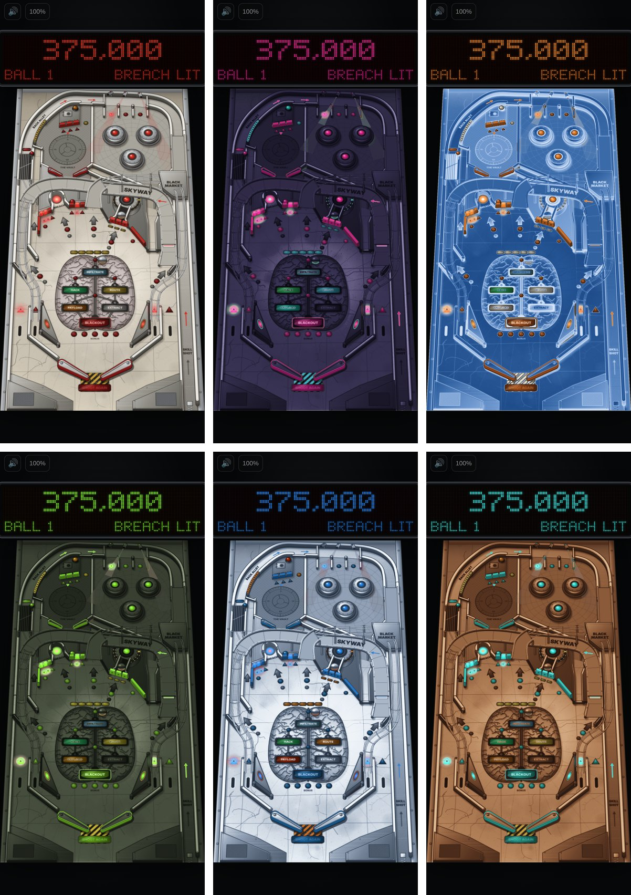

# Colour-scheme previews

Six colour schemes on the same table, made on 30 October 2026 to compare against the current
look. **Cyber Psychosis keeps its current scheme** (concrete and signal red); seeing the others
made that an easy call. Two of the others are set aside as starting points for future tables:

- **Toxic Yard** (green): a post-apocalyptic fallout-shelter vault table.
- **Oxide** (brown and turquoise): a western table.

These are recoloured screenshots of the current build, not changes to the game. Nothing in the
game reads this folder.



Top row: Concrete & Signal Red (current), Neon Noir, Blueprint. Bottom row: Toxic Yard, Arctic
Lab, Oxide.

## Swatches

Each is the game's own palette token put through the scheme: the concrete floor, plate steel,
ink linework, the red insert lights, and the ochre hazard stripes (which also carry the brass,
orange and yellow).

| Scheme | Floor | Steel | Ink | Lights | Stripes | Note |
|---|---|---|---|---|---|---|
| **Concrete & Signal Red** (current) | `#d8cfbd` | `#a8a69f` | `#2a2622` | `#ff2a2a` | `#c79f3b` | Cyber Psychosis. |
| Neon Noir | `#423b5e` | `#2c2742` | `#0f1017` | `#ff2ab1` | `#42b3c7` | |
| Blueprint | `#204e8c` | `#3a6aa8` | `#afbbcc` | `#ff782a` | `#e5e1d2` | Light linework on blue. |
| **Toxic Yard** | `#515947` | `#3a4133` | `#141510` | `#9cff2a` | `#c7b634` | For the vault table. |
| Arctic Lab | `#e6edf3` | `#93a2b6` | `#252c36` | `#2aa3ff` | `#c7722d` | |
| **Oxide** | `#bb8c63` | `#8a5a3a` | `#251812` | `#3fffe5` | `#c79f3b` | For the western table. |

The full ramps (how every shade of the floor and steel maps) are in `schemes.json`.

## Files

| File | What it is |
|---|---|
| `previews/<scheme>-phone.jpg` | The phone view, tilted, in a lit mid-game state. |
| `previews/<scheme>-close.jpg` | A flat close-up of the Breach, the heist map and the brain. |
| `previews/all.jpg` | The six phone views side by side. |
| `schemes.json` | Each scheme: a brightness ramp for the neutral colours, and the hue (with saturation and brightness factors) for the lights and for the stripes. |
| `recolor.py` | Makes the previews and the swatches. |
| `capture.cjs` | Takes the two source screenshots from the running game. |

## How the recolouring works

Neutral pixels (concrete, steel, ink, the brain) go through the scheme's brightness ramp, so
their light and dark relationships stay as drawn. Coloured pixels keep their brightness and
saturation but change hue: the red family (lights, bumper caps, the display) to the scheme's
light colour, the ochre family (hazard stripes, brass, orange and yellow lamps) to its stripe
colour. The job plaques' own colours are left roughly as they are; a real table would choose
them. Outside the table, only the coloured pixels change, so the page and the display's frame
stay dark.

## Regenerating

With the dev server running (`npm run dev`) and Playwright with Chromium available:

```bash
OUT=/tmp/shots node art/palettes/capture.cjs              # phone.png and close.png
python3 art/palettes/recolor.py /tmp/shots art/palettes/previews
python3 art/palettes/recolor.py --swatches                # the swatch table above
```

`recolor.py` needs Python 3 with NumPy and Pillow.
